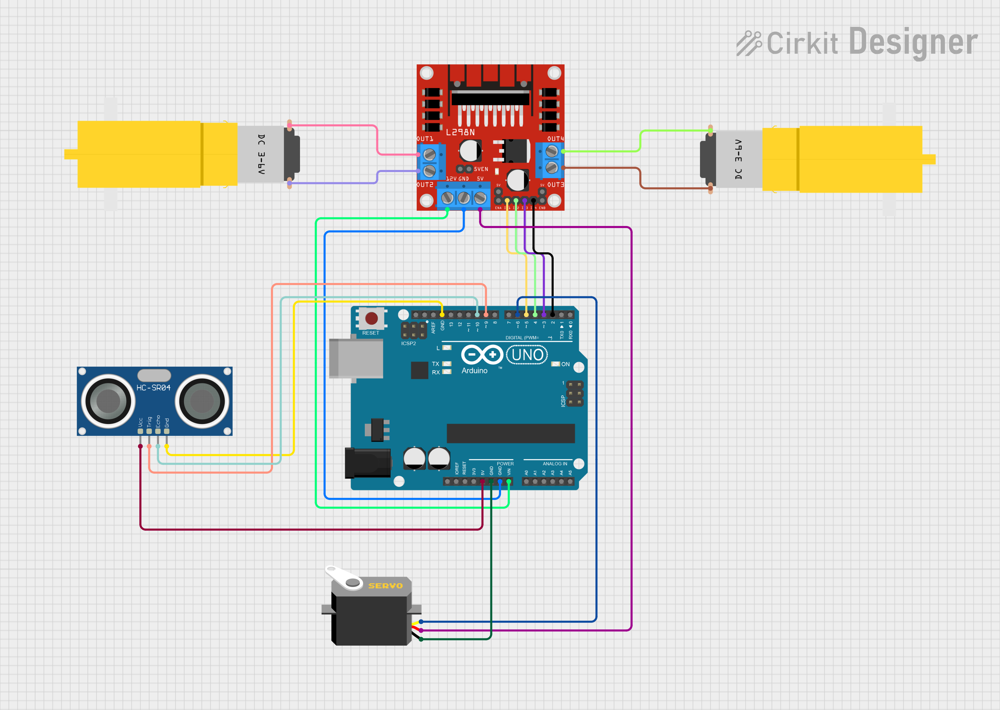
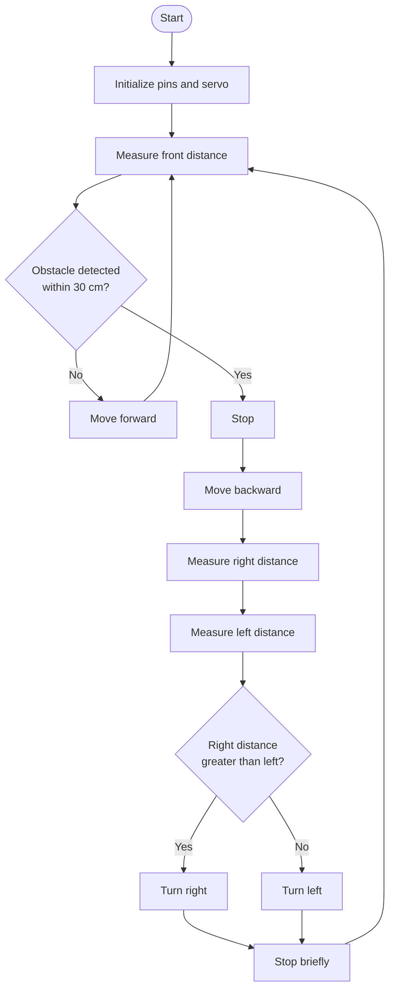

# 🤖 Obstacle Avoiding Robotz

An autonomous mobile robot built with **Arduino Uno**, an **HC-SR04 ultrasonic sensor**, a **servo motor**, and an **L298N motor driver**. The robot measures the distance to objects in front of it and changes direction when an obstacle is detected.

The project demonstrates fundamental robotics and embedded-systems concepts, including ultrasonic distance measurement, servo positioning, motor control, and decision-making.

## ✨ Features

- **Obstacle detection** using the HC-SR04 ultrasonic sensor.
- **Automatic movement** when the path is clear.
- **Servo-based scanning** to measure distances on the right and left.
- **Automatic direction selection** based on the measured side distances.
- **Dual DC motor control** through the L298N motor driver.
- **Serial Monitor output** for observing distance measurements.

## 🧰 Hardware Components

| Component | Quantity | Purpose |
|---|---:|---|
| Arduino Uno | 1 | Main controller |
| HC-SR04 Ultrasonic Sensor | 1 | Measures obstacle distance |
| SG90-compatible Servo Motor | 1 | Turns the ultrasonic sensor |
| L298N Motor Driver | 1 | Controls the DC motors |
| DC Gear Motor | 2 | Drives the robot |
| Robot chassis and wheels | As required | Mechanical platform |
| Battery / suitable motor power supply | 1 | Supplies motor power |
| Jumper wires | As required | Electrical connections |

## 🔌 Circuit Diagram

The following diagram shows the component wiring used for this project.



## 📍 Pin Configuration

The table below follows the pin definitions in `Obstacle_Avoiding_Robot.ino`.

### Arduino Uno to L298N

| Arduino Uno | L298N | Function |
|---|---|---|
| D2 | IN1 | Right motor direction input 1 |
| D3 | IN2 | Right motor direction input 2 |
| D4 | IN3 | Left motor direction input 1 |
| D5 | IN4 | Left motor direction input 2 |

### Arduino Uno to HC-SR04

| Arduino Uno | HC-SR04 | Function |
|---|---|---|
| D9 | TRIG | Trigger signal |
| D10 | ECHO | Echo signal |
| 5V | VCC | Sensor power |
| GND | GND | Ground |

### Arduino Uno to Servo Motor

| Arduino Uno | Servo | Function |
|---|---|---|
| D6 | Signal (usually orange/yellow) | Position control |
| 5V / suitable regulated supply | VCC (usually red) | Servo power |
| GND | GND (usually brown/black) | Ground |

> **Note:** Motor-driver enable pins (ENA and ENB) must be enabled for the motors to operate. If the module uses enable jumpers, check that they are installed. The current sketch controls motor direction through IN1–IN4; it does not generate PWM speed control.

## ⚙️ Working Principle

The robot operates in a continuous sensing and decision-making loop.

1. **Measure distance**  
   The HC-SR04 sends an ultrasonic pulse and measures the time taken for the echo to return.

2. **Check for an obstacle**  
   The Arduino calculates the distance in centimeters. The current sketch uses a threshold of **30 cm**.

3. **Move forward**  
   If no valid obstacle reading within the threshold is detected, the robot continues moving forward.

4. **Stop and reverse**  
   When an obstacle is detected at a distance greater than 0 cm and less than or equal to 30 cm, the robot stops briefly and moves backward.

5. **Scan the surroundings**  
   The servo points the ultrasonic sensor to the right and then to the left to measure the available distances.

6. **Choose a direction**  
   The Arduino compares both measurements:
   - If the right-side distance is greater, the robot turns right.
   - Otherwise, the robot turns left.

7. **Continue navigating**  
   After turning, the robot stops briefly and repeats the sensing process.

## 🧠 Decision Flow



## 💻 Software Requirements

- [Arduino IDE](https://www.arduino.cc/en/software)
- Arduino Uno board package
- USB cable compatible with the Arduino Uno
- Built-in Arduino `Servo` library

The sketch also includes `Wire.h`. No additional third-party library is required by the current source code.

## 🚀 Getting Started

### 1. Clone the repository

```bash
git clone https://github.com/beryldumanao/ObstacleAvoidingRobot.git
```

### 2. Open the project

Open the file below using Arduino IDE:

```text
ObstacleAvoidingRobot/
└── Obstacle_Avoiding_Robot.ino
```

### 3. Connect the hardware

Connect the Arduino Uno, L298N, HC-SR04, servo motor, and DC motors according to the circuit diagram and pin configuration above.

### 4. Select the Arduino board and port

In Arduino IDE:

- Select **Tools → Board → Arduino AVR Boards → Arduino Uno**.
- Select **Tools → Port** and choose the port connected to your Arduino.

### 5. Upload the program

Open `Obstacle_Avoiding_Robot.ino`, click **Upload**, and wait for the upload process to finish.

### 6. Test the robot

Place the robot on a clear, flat test area. Power the motor driver using an appropriate motor supply and observe its movement as obstacles are placed in front of the sensor.

## 🔋 Power and Wiring Notes

- Use an appropriate external supply for the DC motors; do not power the motors directly from an Arduino I/O pin.
- Connect Arduino GND and L298N GND together so the control signals share a common ground.
- Check the voltage and current requirements of the servo before choosing its power source.
- Check wiring polarity and connections before powering the circuit.
- Keep the wheels clear of the surface while checking the initial motor direction.

## 📁 Project Structure

```text
ObstacleAvoidingRobot/
├── Obstacle_Avoiding_Robot.ino
├── circuit_image.png
└── README.md
```

## 🔮 Possible Improvements

- Add PWM-based motor speed control.
- Improve distance measurement reliability with multiple readings or filtering.
- Add battery-voltage monitoring.
- Add status indicators or a buzzer.
- Improve turning accuracy and navigation behavior.

## 👨‍💻 Author

**Beryl Dumanao**

GitHub: [@beryldumanao](https://github.com/beryldumanao)

---

*This project is developed as a practical introduction to Arduino programming, embedded systems, and autonomous mobile robotics.*
